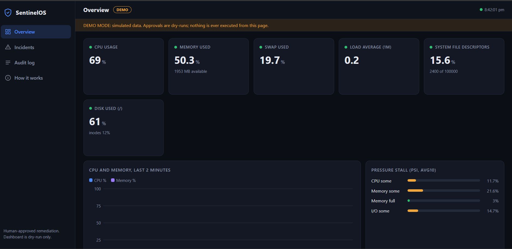
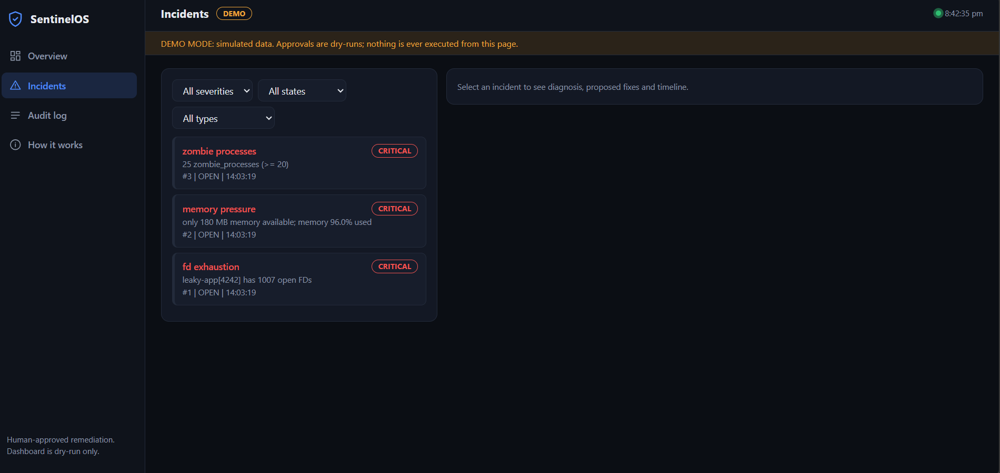
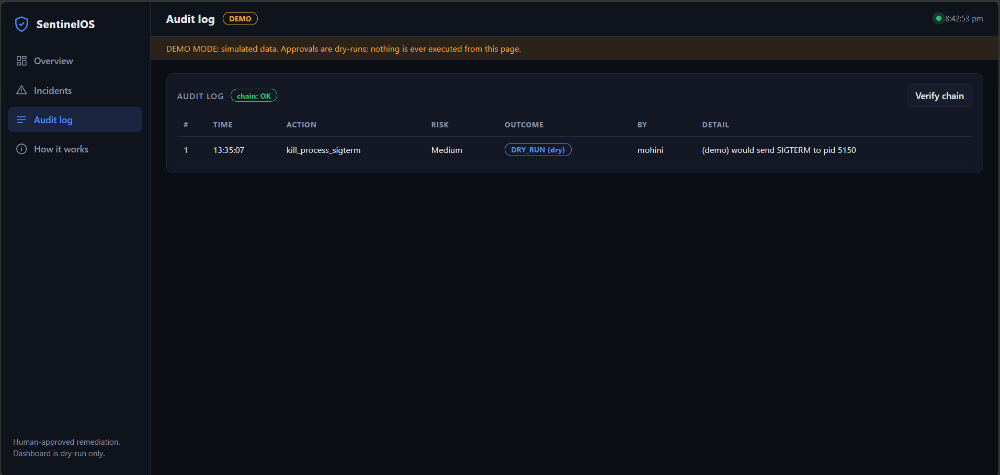
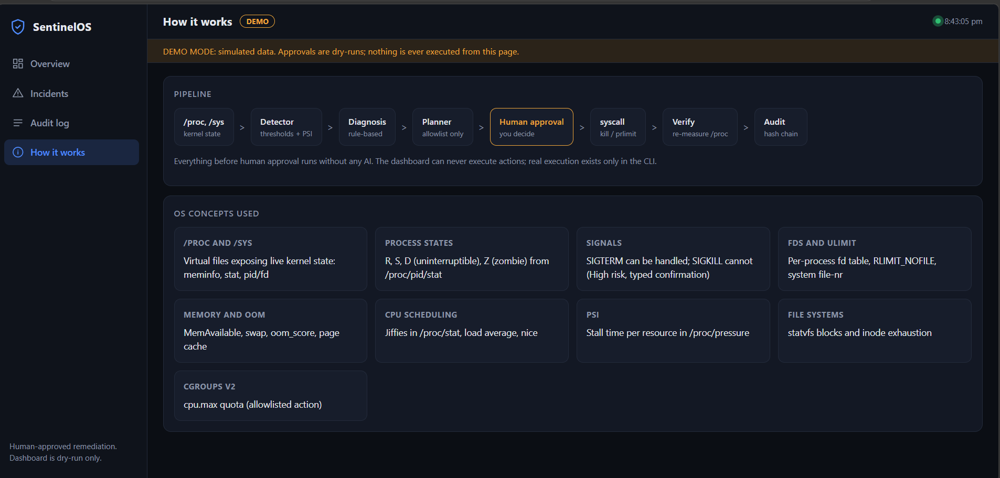

# SentinelOS

**AI-assisted Linux failure diagnosis and safe, human-approved remediation.**

SentinelOS reads raw kernel data from `/proc`, `/sys` and PSI, detects OS-level failures (file descriptor leaks, memory pressure, CPU saturation, zombies, disk and inode exhaustion), explains the root cause, proposes ranked fixes, and runs a fix **only after a human approves it**. After every fix it re-measures the system and rolls back if things got worse. Every decision goes into a tamper-evident audit log.

The core runs **without any AI**. Diagnosis is rule-based. An LLM is an optional, local-only layer that explains incidents in plain English and can never run an action.



## Why this project

When a Linux server fails, an admin has to notice it, run `top`, `dmesg`, `lsof`, interpret the output and then run a fix carefully. A wrong command can make things worse. Fully automatic "self-healing" scripts act without understanding or oversight. SentinelOS sits in between: automatic detection and diagnosis, human decision, verified execution.

## How it works

```
/proc, /sys, PSI -> Detector -> Incident bundle -> Diagnosis -> Planner
-> Human approval -> syscall (kill / setpriority / prlimit) -> Verify (/proc again) -> Audit log
```

1. **Monitor** reads raw `/proc` files directly (no library needed).
2. **Detector** applies thresholds from `config/thresholds.yaml`, with dedup and cooldown.
3. **Incident bundle** snapshots top processes by CPU, memory and FDs plus journal/dmesg lines.
4. **Diagnosis** (rule-based) outputs root cause, confidence, evidence and culprit.
5. **Planner** maps the diagnosis to allowlisted actions only, ranked by risk.
6. **Approval** happens in the CLI. The dashboard can only dry-run.
7. **Executor** runs the action, **Verifier** re-measures, and rolls back if worse.
8. **Audit log** is a SHA-256 hash chain; any edited or deleted row breaks it.



## OS concepts used

| Concept | Where it appears |
|---|---|
| `/proc` virtual filesystem | `meminfo`, `stat`, `loadavg`, `<pid>/stat`, `<pid>/status`, `<pid>/fd`, `oom_score`, `sys/fs/file-nr` parsed directly |
| Process states (R, S, D, Z) | State field of `/proc/<pid>/stat`; zombie and D-state detection |
| fork / exit / wait | `faults/zombie_maker.c` creates zombies; diagnosis finds the non-reaping parent via `ppid` |
| Signals | SIGTERM first; SIGKILL is a separate High-risk action needing typed confirmation |
| File descriptors, ulimit | Per-process FD count, system `file-nr`, `prlimit(RLIMIT_NOFILE)` |
| Memory management | `MemAvailable` vs `MemFree`, swap, `oom_score`, page cache, `drop_caches` |
| CPU scheduling | CPU % from two `/proc/stat` jiffy samples, load average, `nice` |
| PSI | `/proc/pressure/{cpu,memory,io}` stall percentages |
| File systems | `statvfs` block and inode usage |
| cgroups v2 | CPU quota action in the allowlist |
| Privilege and protection | PID 1, sshd, systemd and the agent itself are protected |
| PID reuse | PID identity re-checked between approval and execution |

## Safety design

- **Allowlist only.** No free-form shell, ever. Parameters are schema-validated.
- **Risk tiers:** Low, Medium, High (typed confirmation required), Forbidden (always blocked).
- **Protected targets:** PID 1, sshd, systemd, the agent, root processes without a tty.
- **Dry-run by default.** Real execution needs `SENTINEL_DRY_RUN=false` and `--execute`.
- **Verify and rollback** after every action.
- **Rate limit and cooldown** to prevent fix loops.
- **Prompt-injection defense:** log text is untrusted data, shown as text and never obeyed. The LLM never receives log lines.
- **Dashboard cannot execute.** Real execution exists only in the CLI.
- **Tamper-evident audit log** (hash chain, `verify_chain()`).



## Quick start (Ubuntu / WSL2)

```bash
sudo apt install -y python3-venv python3-pip build-essential
git clone https://github.com/mohini198/SentinelOS.git
cd SentinelOS
python3 -m venv .venv && source .venv/bin/activate
pip install -e ".[dev]"
python -m pytest -q
```

### Live demo (3 terminals)

```bash
python -m sentinelos.main monitor                    # T1: detects incidents
python3 faults/fd_leak.py --max-fds 1000             # T2: injects an FD leak
python -m sentinelos.main incidents                  # T3: list, then:
python -m sentinelos.main review <id>
SENTINEL_DRY_RUN=false python -m sentinelos.main approve <id> 2 --execute --by <name>
python -m sentinelos.main audit-show
```

Other faults: `faults/cpu_hog.sh`, `faults/zombie_maker.c`, `faults/mem_leak.py`.

### Dashboard

```bash
SENTINEL_DEMO=true uvicorn sentinelos.api.app:app --port 8000   # safe demo data
uvicorn sentinelos.api.app:app --port 8000                      # live mode, local only
```

Never expose live mode publicly.

### Optional local LLM explanation

```bash
export SENTINEL_LLM_KEY="your-key"
export SENTINEL_LLM_MODEL="model-name"
```

Disabled in demo mode. Advisory only.



## Project layout

```
sentinelos/
  monitor/    raw /proc, PSI and disk readers
  detector/   thresholds, dedup, cooldown
  incident/   evidence bundles
  diagnosis/  rule engine and OS concept notes
  actions/    allowlisted actions, guards, schema validation
  planner.py  diagnosis -> ranked proposals
  executor.py approval, verify, rollback, rate limits
  audit.py    hash-chained audit log
  api/        FastAPI backend and dashboard
  llm.py      optional explanation layer
config/       thresholds, allowlist, protected processes
faults/       fault injection scripts
tests/        140+ tests including safety tests
```

## Testing

140+ pytest tests cover the readers (fake `/proc` trees), detector, diagnosis, actions, executor, API and a dedicated safety suite (protected processes, prompt injection, PID reuse, rate limits, forbidden actions).

## Limitations

- Tested on WSL2 Ubuntu; PSI and cgroup behaviour can differ on other kernels.
- The memory-leak scenario is covered by unit tests but not yet demonstrated end to end.
- cgroup quota, `drop_caches` and `systemctl` actions require root.
- Lowering a nice value back (rollback of renice) requires privileges.
- User-space tool: it uses `/proc` and system calls, not kernel modules.

## Roadmap

cgroup v2 memory caps instead of kill, eBPF tracing for evidence, `pidfd_open` to remove the PID reuse race, multi-host support.

## Author

**Mohini**

## License

MIT